<h1 align="center">pracfile</h1>

<b>Make your 7th sem lab files. Pick a lab, type your name, download.</b>

  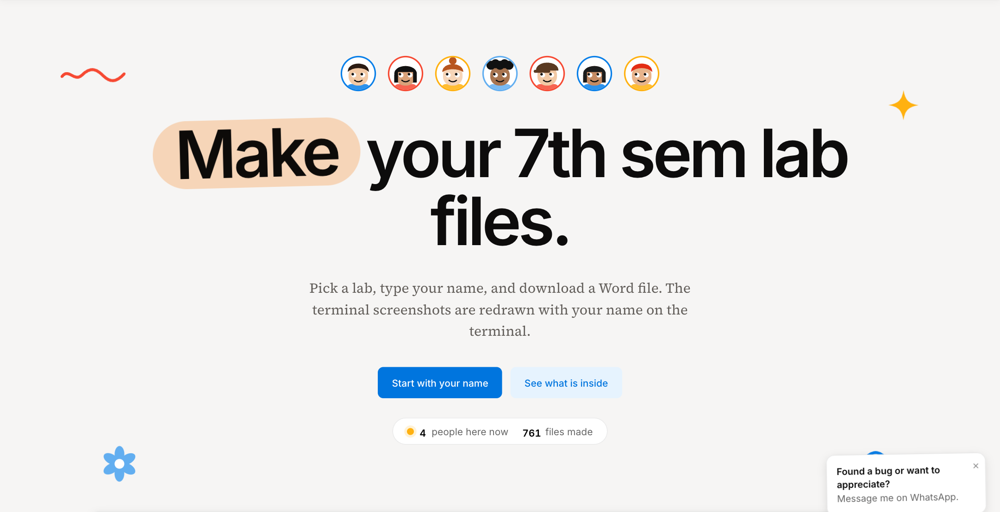

> **Showcase repository: screenshots, product thinking and anonymous analytics only. Source code is closed.**

---

## The 30-second version

Every semester, every engineering student has to submit a **lab record file**: the aim, theory, program, output screenshot and result for each experiment, printed and signed. It is one of the most repetitive, least educational jobs in college, and it eats a full weekend per subject.

**pracfile** removes the busywork. A student picks a lab, types their name, and gets a finished, properly formatted Word or PDF file in a few seconds, with **their own name on the cover and on every terminal screenshot**. No sign-up, no app, no queue.

| | |
|---|---|
| **Labs covered** | 5 labs, 55 experiments, plus 4 case studies (9 downloadable products) |
| **Time to a finished file** | a few seconds (median **3.3 s** click to file) |
| **Login** | none |
| **Install** | none, runs in the browser, works on phones |
| **First 27 hours live** | **255** unique visitors, **758** files delivered, **97.3 %** success rate |

---

## Table of contents

1. [The problem](#1-the-problem)
2. [The idea](#2-the-idea)
3. [What it does](#3-what-it-does)
4. [Screenshots](#4-screenshots)
5. [How it works](#5-how-it-works)
6. [Where the content comes from](#6-where-the-content-comes-from)
7. [Design decisions I am proud of](#7-design-decisions-i-am-proud-of)
8. [Safety, privacy and being honest](#8-safety-privacy-and-being-honest)
9. [Launch analytics (anonymous)](#9-launch-analytics-anonymous)
10. [What I learned](#10-what-i-learned)
11. [Built with](#11-built-with)
12. [About this repository](#12-about-this-repository)

---

## 1. The problem

A lab record is not hard, it is **long**. For one subject a student must produce, for each of 9 to 15 experiments:

- an aim and a short theory section,
- the program, formatted and readable,
- a **screenshot of the program running in a terminal**,
- graphs or tables, where the experiment needs them,
- a result line, and (in many labs) viva questions.

What actually happens in a hostel room the night before submission:

| What students do today | Why it hurts |
|---|---|
| Copy an old senior's file | Same name, same laptop name, same screenshot as 40 other people, and teachers notice |
| Run every program themselves and screenshot each one | Environment setup alone can take hours, and one bad library version breaks everything |
| Paste random code from the internet | Code that does not match the syllabus, outputs that do not match the code |
| Share files over WhatsApp | Unknown quality, no formatting standard, nobody owns fixing mistakes |
| Pay someone | Costs money and still arrives with the wrong name on it |

The real pain is not "I cannot write the program". It is the **last 20 %**: formatting, screenshots, the name on every page, and getting everything to look like it came from *your* laptop.

---

## 2. The idea

> **One verified, generic lab file per subject. Personalised in the browser, at download time, for each student.**

Three principles shaped everything:

1. **Correct first.** Every program is actually run, and every output and graph in the file is the real output of that program. No decorative fake screenshots.
2. **Personal where it counts.** Name, roll number, group, faculty on the cover. The student's own name and computer name inside every terminal screenshot, redrawn per person so no two files are identical.
3. **Zero friction.** No account. No install. Mobile friendly. If it takes more than a minute, it failed.

The second principle is the interesting one. Instead of storing thousands of near-identical files or running a render server, the site keeps **one master copy per lab** and builds each student's version on their own device. That makes it cheap to host and fast to deliver, because the heavy work happens on the student's device instead of a render server.

---

## 3. What it does

**Choose** one of nine tiles: PRCV, ML, DWDM, DS, RLDL, or one of four case studies.

**Personalise** with name, roll number, group, faculty, branch, semester and the computer name that appears in the terminal prompt. Only the name is required.

**Preview** the terminal screenshots live while typing. The prompt changes as the name changes, experiment by experiment.

**Options** that matter: an optional viva-voce page (five questions with answers after each practical) that appears only for labs that have one.

**Download** as a Word file (editable, so a student can tweak anything their teacher wants) or a ready-to-print PDF.

| Product | Experiments / programs | Course code |
|---|---|---|
| PRCV | 9 experiments | ML-411P |
| ML | 10 experiments | CIE-421P |
| DWDM | 12 experiments | CIE-425P |
| DS | 9 experiments | CIE-405P |
| RLDL | 15 experiments | ML-409P |
| PRCV case studies 1 and 2 | 2 programs each | ML-411P |
| ML case studies 1 and 2 | 2 programs each | CIE-421P |

Small touches that make it feel alive: a live "people here now" counter, a running count of files made, a WhatsApp bubble for bug reports, an honest **"Do it at your own risk"** card, and a FAQ written in the way students actually ask questions.

---

## 4. Screenshots

### Landing

### The maker: pick a lab, type your name, watch the terminal change

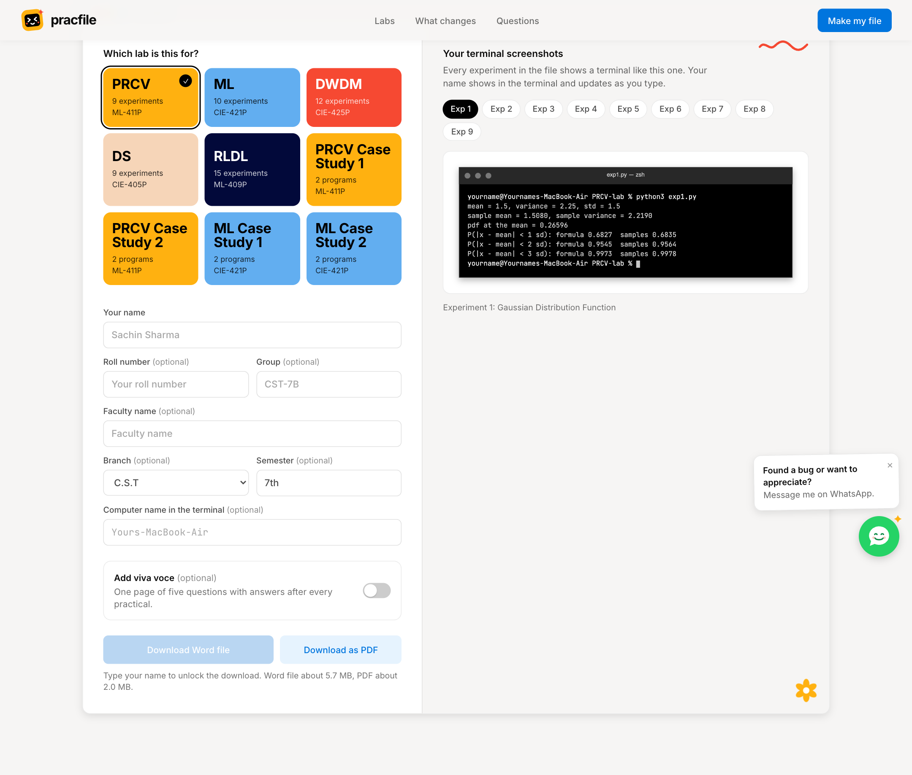

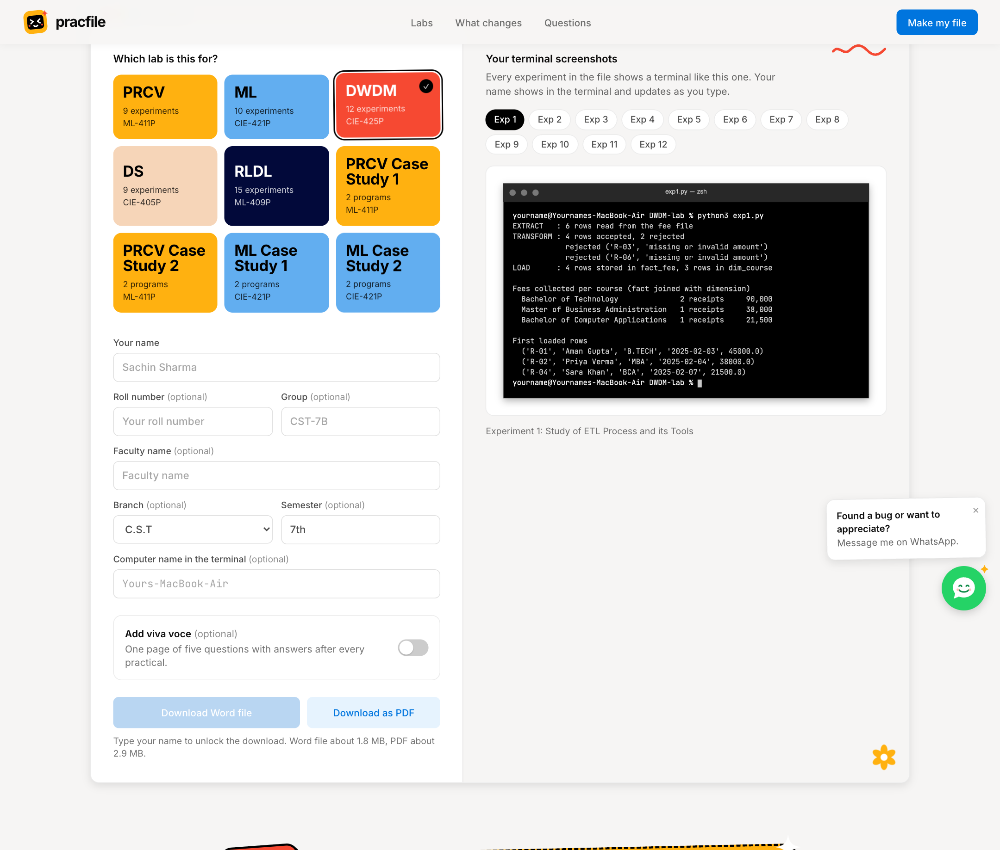

### What changes and what stays the same

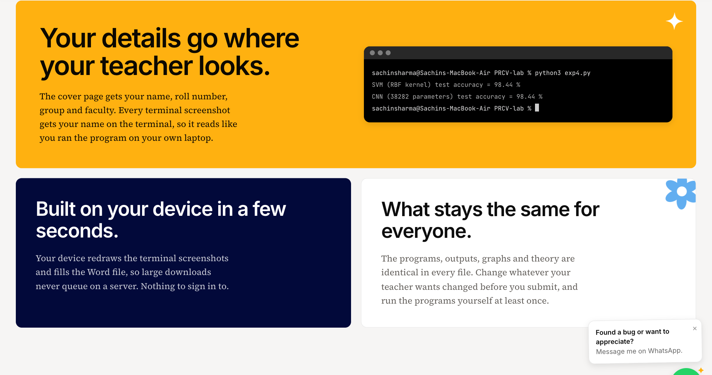

### Honest disclaimer, with some personality

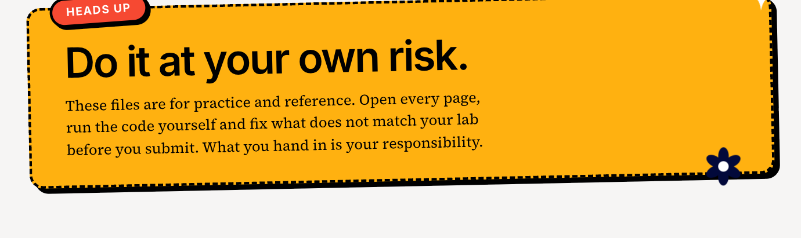

### Everything that is live

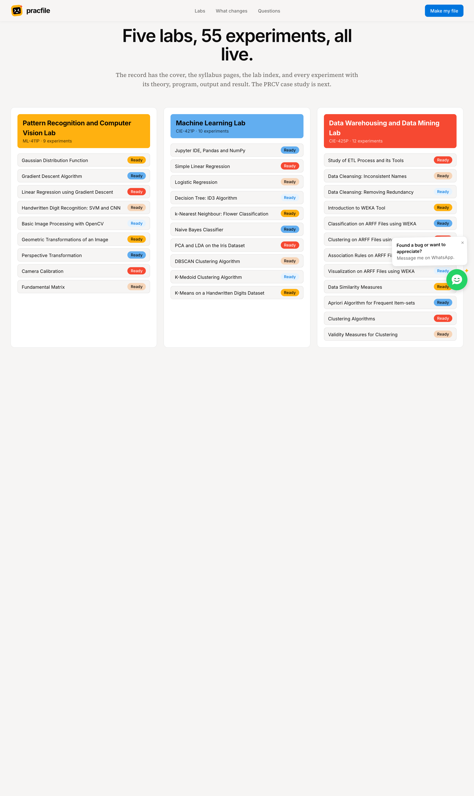

### Questions students actually ask

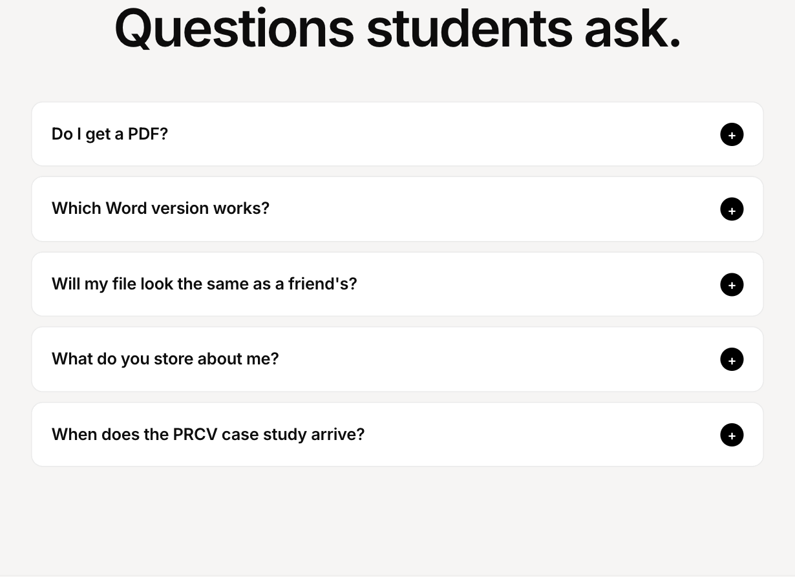

### On a phone (most students use one)

<table>
<tr>
<td>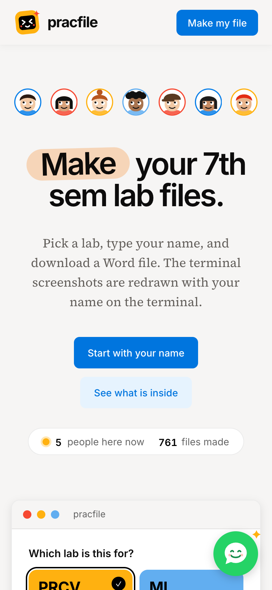 Mobile landing</td>
<td>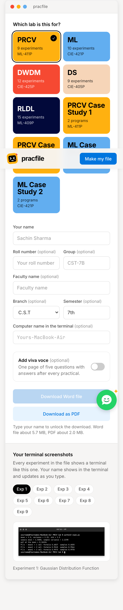 Mobile maker</td>
</tr>
</table>

---

## 5. How it works

### The student journey

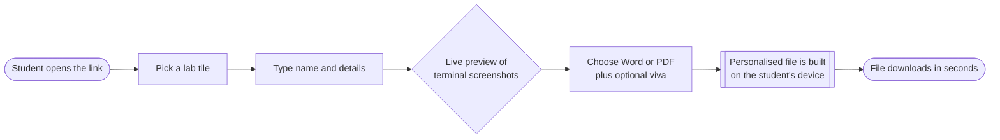

### System architecture (public level)

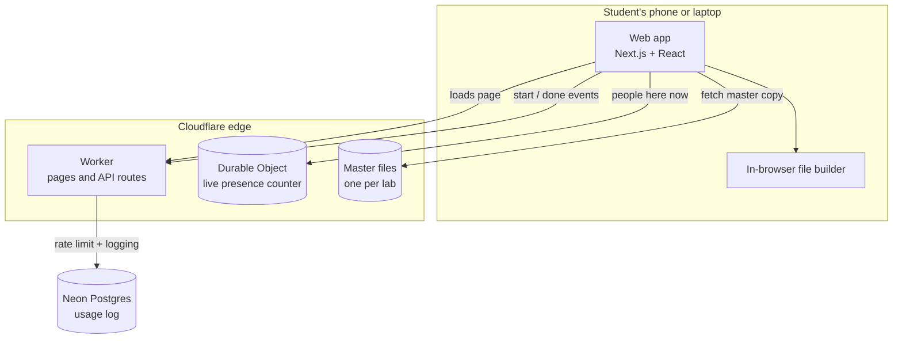

### Request lifecycle

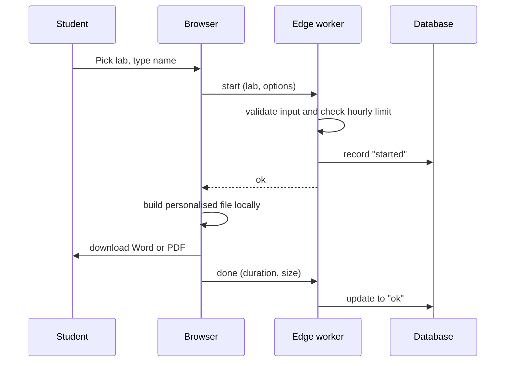

### Why "build on the device"?

| Approach | Problem |
|---|---|
| Pre-render a file per student on a server | Heavy compute, long queues exactly when everyone needs it (the night before submission) |
| Store thousands of ready files | Storage cost, and every file contains someone's name |
| **One master per lab, personalised in the browser** | Static hosting speed, near-zero cost per download, scales with the crowd instead of against it |

The last one is what pracfile does. A burst of 130 downloads in a single hour (the real launch peak, below) costs the server almost nothing, because each student's browser does its own work.

---

## 6. Where the content comes from

The product is only as good as the lab material, so most of the effort went into the content, not the website.

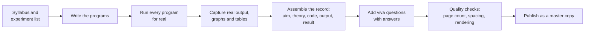

What that pipeline gave the files:

- **Real outputs.** Numbers in the output match what the code prints, including graphs.
- **Consistent look.** Same headings, spacing and code style across all five labs.
- **Readable code.** Programs are formatted with breathing room, because a wall of dense code is how students lose marks for presentation.
- **Case studies** with real data and real metrics, not placeholder text.
- **Viva voce** sets for labs that need them, five questions per practical with answers.

---

## 7. Design decisions I am proud of

**No login, ever.** Asking a stressed student to create an account at 11 PM is how you lose them. The only input is a name.

**The name appears where it matters.** Not just the cover. Every terminal screenshot shows the student's name and computer name in the prompt, the thing a teacher actually glances at.

**Live preview before commitment.** You see the terminal change as you type, so there is no "download, find the typo, redo".

**Editable Word first, PDF second.** Teachers ask for changes. A locked PDF is a dead end, so Word is the primary button.

**Viva toggle only when it exists.** The option disappears for labs that have no viva set, so the UI never offers something that is not there.

**A rate limit that is gentle but real.** A per-hour limit per user keeps one person from hammering the service, and the message tells them to wait rather than just failing.

**Playful, human design.** Cheerful avatars, bold colour tiles, hand-drawn squiggles, a copy tone that sounds like a classmate and not a corporation. Students trust what feels like it was made by one of them, because it was.

**Honesty built in.** A visible "Do it at your own risk" card and a line telling students to **run the programs themselves at least once** and change whatever their teacher wants changed. The tool saves formatting time, it does not replace understanding.

---

## 8. Safety, privacy and being honest

- **No accounts and no passwords.** There is nothing to leak.
- **A usage log is kept.** Each download request is logged (lab chosen, outcome, timing, basic device and approximate location, and the details typed into the form) so the service can be rate limited, debugged and measured. It is private, access is restricted, and none of it is published.
- **Input is sanitised** before use, and requests are validated server side.
- **Per-hour rate limit** to prevent abuse of a free service.
- **Secrets stay in the platform's secret store**, never in the repository.
- **Clear disclaimer** on the page, and a direct way to report bugs.
- **This showcase contains no personal data.** Everything below is an aggregate. No names, roll numbers, IP addresses or per-person records appear anywhere in this repository.

---

## 9. Launch analytics (anonymous)

First **27 hours** after going live, measured from the product's own usage log (IST). Everything here is aggregated and anonymous.

### Headline numbers

| Metric | Value |
|---|---|
| Page views | **549** |
| Unique visitors | **255** |
| Files delivered | **758** |
| Success rate | **97.3 %** |
| Returning visitors | **127** (50 %) |
| Visitors who downloaded at least once | **154** (60 %) |
| Visitors who downloaded 3 or more files | **88** (35 %) |
| Median time from click to finished file | **3.3 s** |
| Average file size | **about 3 MB** |
| Total data delivered | **about 2.3 GB** |
| Real-time peak | **132 downloads in a single hour** |

### Traffic, hour by hour

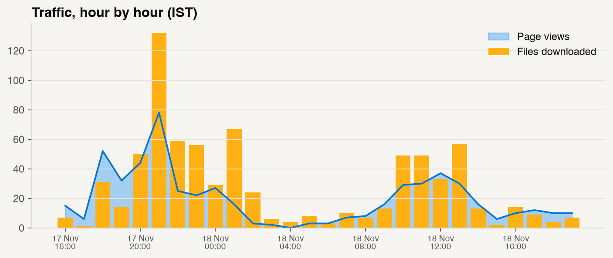

It spread by word of mouth in class group chats: a first wave on the evening it launched, a quiet night, and a second wave the next morning as more classes found it. The peak hour carried **132 downloads**, handled with no queue, which is exactly the burst the "build on the device" design was meant for.

### When students use it

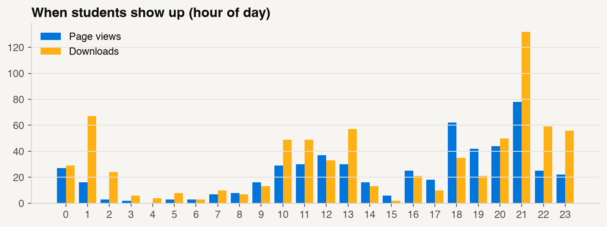

Two clear rhythms: **late evening to midnight** (the night-before-submission crunch) and **mid-morning to lunch** (between classes). Almost nothing from 3 AM to 7 AM.

### From visit to download

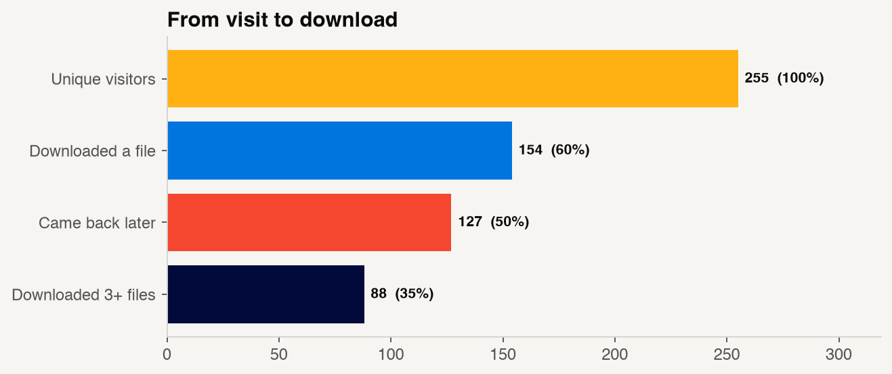

**60 %** of visitors downloaded something, which is very high for a tool with no onboarding. Half of all visitors **came back**, and **35 %** came back to grab three or more files.

### Which labs people want

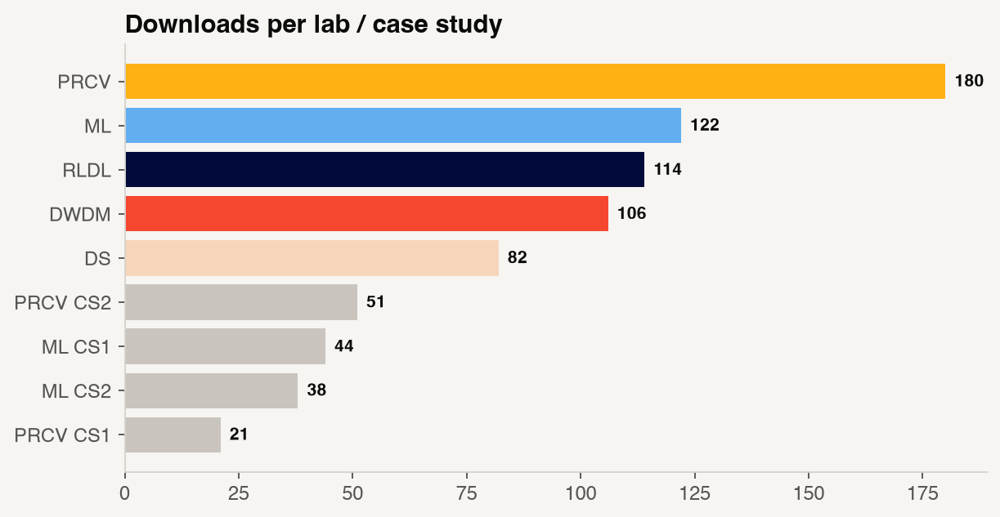

| Rank | Product | Downloads | Share |
|---|---|---|---|
| 1 | PRCV | 180 | 23.7 % |
| 2 | ML | 122 | 16.1 % |
| 3 | RLDL | 114 | 15.0 % |
| 4 | DWDM | 106 | 14.0 % |
| 5 | DS | 82 | 10.8 % |
| 6 | PRCV case study 2 | 51 | 6.7 % |
| 7 | ML case study 1 | 44 | 5.8 % |
| 8 | ML case study 2 | 38 | 5.0 % |
| 9 | PRCV case study 1 | 21 | 2.8 % |

The four case studies were added **after** launch and still took about **a fifth of all downloads**, so they are worth the effort.

### Students who grabbed the whole set

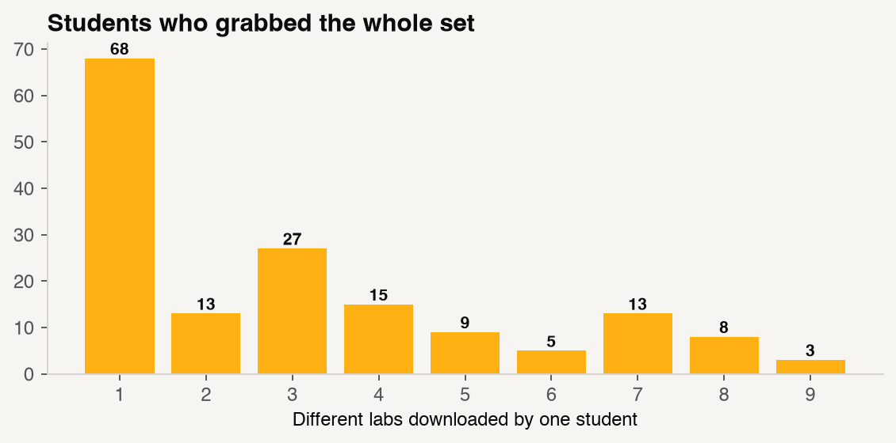

A large group did not stop at one subject. They downloaded **three or more different labs** in one sitting, which is the clearest sign the product fixes the actual problem (the whole semester's pile), not just one file.

### Where visitors come from

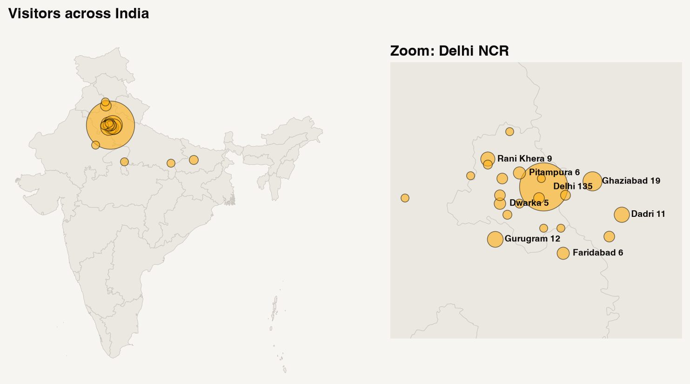

About **96 %** of visitors are in India, and **over half sit inside Delhi NCR**: Delhi itself, Ghaziabad, Gurugram, Greater Noida, Faridabad and the surrounding localities, with a few visitors from Haryana, Punjab, Bihar, Rajasthan and Uttarakhand. Location is approximate, detected from the network, not exact. The handful of visitors outside India were almost all cloud crawlers, not students.

### Devices

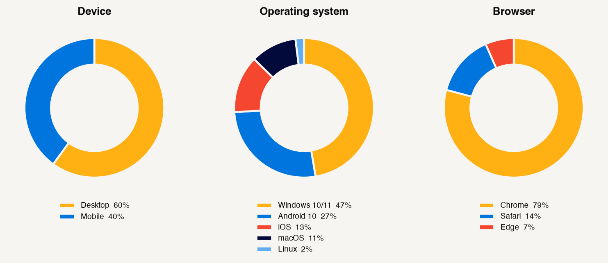

**About 40 % of downloads came from phones.** Students download first and print later, so mobile had to be a first-class citizen, not an afterthought. Chrome dominates, with Safari on iPhones next.

### Loyalty and speed

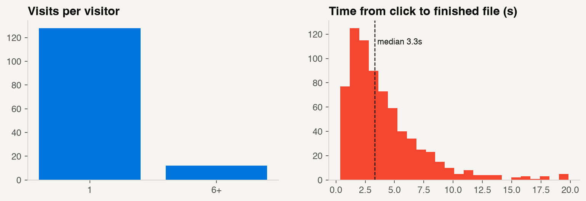

Left: how many times each visitor came back. Right: how long each download took end to end. The distribution is tight, with a median of **3.3 seconds**, even while 130 students were hitting the site in the same hour.

### Reliability

| Outcome | Count |
|---|---|
| Completed | 758 |
| Politely stopped by the hourly limit | 7 |
| Rejected as bad input | 5 |
| Left before finishing | 9 |

---

## 10. What I learned

1. **The boring part is the product.** Students did not want a clever website. They wanted their weekend back. Most of the value is the verified content and the polish on it.
2. **Free, instant, no-login wins.** 60 % of visitors converting with zero onboarding says friction was the enemy all along.
3. **Move work to the user's device.** It turned a "server melts on submission night" problem into a non-problem, and kept hosting cost near zero.
4. **Design for a stressed person at midnight on a phone.** Big tiles, one required field, instant feedback.
5. **Add the second wave of content after launch.** The case studies came from watching what students asked for next.
6. **Be honest in the product.** The disclaimer and the "run it yourself once" nudge cost nothing and set the right expectation.
7. **Aggregates are enough.** Every decision in this document came from counts and trends, never from looking at individuals, which is also why the public write-up can be fully anonymous.

---

## 11. Built with

| Concern | Tool |
|---|---|
| App framework | Next.js (App Router), React |
| Styling and motion | Tailwind CSS, framer-motion |
| Hosting | Cloudflare Workers (via OpenNext) |
| Live presence counter | Cloudflare Durable Objects |
| Usage log | Neon serverless Postgres |
| Lab content | Python, run for real, assembled into documents |
| Charts in this README | Python, matplotlib |

This is the public dependency surface, not the implementation. The file-building logic, the content pipeline internals and the lab material itself stay out of this repository.

---

## 12. About this repository

This is a **showcase-only** repo: screenshots, product write-up and anonymous aggregate analytics, published to share the project publicly without exposing the implementation or any user's data. The real source lives in a private repository.

`analytics/make_charts.py` is included to show how the charts were generated from aggregate counts. It does not contain data and cannot be run without the private usage log.

## License

All rights reserved. The name, design, screenshots and underlying application are proprietary; nothing in this repository is licensed for reuse.
